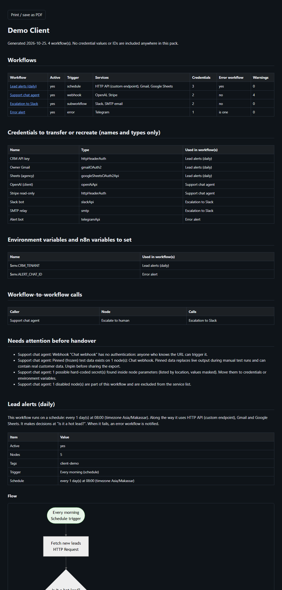

# n8n-handover-docs: a client handover pack from your n8n workflows, without the 2-hour call


> **Best-effort: read every pack before you send it to a client.** Notes are hidden by default and an independent scanner checks the finished files, but no automatic redaction is perfect. See [What this does not promise](#what-this-does-not-promise).



**You built 15 automations. The client's next developer opens n8n and sees 15 boxes with no explanation. This writes the explanation.**

Point it at exported workflow JSON (or your live n8n API, read-only) and it produces, per workflow and as an index:

- what it does in plain English, what triggers it, and the schedule (cron expressions are translated)
- a step list and a Mermaid flowchart, with IF / Switch branches and AI agent model/tool/memory links labelled
- external services touched, credential **names and types** only, env vars and `$vars` referenced
- webhooks (method + shortened path), error handling present or missing, rate limits and caps, sub-workflow calls
- warnings: pinned data, hard-coded secrets (location only, value masked), webhooks with no auth
- a "When it breaks" runbook per service (auth expired, 429, schema change) with the node names to look at
- `inventory.csv`: workflow x service x credential, safe to open in Excel

Zero dependencies. Node 20+. A full generated sample is in [examples/sample-pack/](examples/sample-pack/) (open `index.html`, or read the `.md` files on GitHub where the diagrams render).

## 60-second quickstart

From exported JSON (n8n: workflow menu > Download):

```bash
git clone https://github.com/waseemnasir2k26/n8n-handover-docs.git
cd n8n-handover-docs
node bin/n8n-handover-docs.js --from-dir path/to/exports --out handover --title "Client name"
```

From a live n8n (public API, GET only):

```bash
export N8N_BASE_URL=https://n8n.example.com
export N8N_API_KEY=...            # Settings > n8n API. Read from env only, never written anywhere
node bin/n8n-handover-docs.js --live --tag client-x --active-only --out handover
```

Try it without any n8n: `npm run demo` (builds `examples/sample-pack` from `examples/workflows`).

| File                        | What it is                                                                                                                                                         |
| --- | --- |
| `index.html`                | One self-contained page: overview, credential list to transfer, env vars to set, every workflow in full. Print CSS included: open it and use "Print / save as PDF" |
| `index.md`, `<workflow>.md` | The same content as GitHub-friendly Markdown with `mermaid` blocks                                                                                                 |
| `inventory.csv`             | Workflows x services x credentials. Formula-injection safe                                                                                                         |

## Options

| Flag | Meaning |
| --- | --- |
| `--from-dir <folder>` | Folder of exported `.json` (single workflow, array, or `{data:[...]}` API shape; searched recursively) |
| `--live` | Read from the n8n public API. `--tag`, `--active-only`, `--limit` narrow it |
| `--out <folder>` | Default `./handover` |
| `--title <text>` | Pack title, e.g. the client name |
| `--show-hosts` | Show real webhook URLs and HTTP hostnames (default: hidden) |
| `--show-webhook-paths` | Show full webhook paths (default: first 4 characters, because a path works like a password) |
| `--redact-contacts` | Also hide e-mails and phone numbers in workflow names, tags and credential names |
| `--keep-contacts` | Do not hide e-mails and phone numbers in sticky notes (default: hidden) |
| `--include-notes` | Include sticky-note text (hidden by default; redacted best-effort) |
| `--no-gitleaks` | Skip the gitleaks pass of the final gate (it runs automatically when gitleaks is on PATH) |
| `--allow-findings` | Write the pack even if the final gate finds something (exit code 3 otherwise) |
| `--diagram-fallback` / `--offline` | Diagrams as text with the reason shown, no script in the HTML |
| `--llm` | Add a plain-English AI summary per workflow (see below) |
| `--date YYYY-MM-DD` | Date printed in the pack (reproducible output) |

The HTML loads Mermaid 11.4.1 from jsDelivr with a pinned version and an SRI hash. If it cannot load, the diagram source stays visible as text.

## What is in the pack, and what is not (best-effort)

**The structure is the product; free text is not.** The pack describes how workflows are wired. It does not try to carry what people typed into them.

- **Sticky notes are hidden by default.** The index says "N sticky note(s) hidden (use --include-notes to include them)". Keep them hidden unless you have read them: notes are free text, and free text is where secrets and personal data end up.
- **What `--include-notes` covers.** Notes are included after a stricter pass than names. Credential words in <!-- langs:start -->English, Spanish, Portuguese, French, German, Turkish, Indonesian, Vietnamese, Russian, Arabic, Hindi, Urdu, Thai, Japanese, Korean, Chinese<!-- langs:end --> hide the value after them (and up to a few words after a password word). PIN-style labels (pin, otp, door / gate / safe / alarm / security / verification code) hide a numeric, spoken-digit ("four eight two one") or NATO-word ("tango alpha") value; the key and lock emoji (🔑 🔐 🗝️ 🔒) work as labels too. Spaced digit runs ("4 8 1 5 9 2"), card and IBAN-style groups and SSN-shaped numbers are hidden, as are e-mails, phone numbers and URLs. **Not detected:** street addresses, people's names, health or financial details written in plain prose, and any secret with no label and no digit or symbol. Never send a pack made with `--include-notes` without reading it.
- **Never read at all:** credential values and IDs, parameter values, pinned test data, node `notes` and descriptions, Code node bodies. Hard-coded secrets in parameters are reported by node and field as `[masked, N chars]`, never copied.
- **Names are shown** (workflow, node, tag, credential, sub-workflow, connection and node types, variable names) after a name policy. The text is normalised first (Unicode NFKC, zero-width characters, HTML entities, %-encoding, markdown wrappers, look-alike Cyrillic and Greek letters). Credential words are matched as **whole words**, never as parts of words, and a credential word alone is not a secret: "Send Token Report", "Passenger booking" and "Keyword research" are untouched. Only the **value** is replaced with `[redacted]`: a value-looking token after the word ("token: ghp\_...", "api_key=..."), a token that looks like a key on its own (long letters-and-digits mix, hex, base64, high entropy), the words assigned to a password word ("password is horse battery staple"), or a whole name that is one short password-like token ("hunter22", "k9x!2q"). The other words stay, and file names are the workflow's safe words plus a short hash (`call-crm-h4f3a21.md`). The index says how many names were touched.
- **Fixed vocabularies only** for everything else taken from parameters (HTTP methods, auth types, time units, numbers). Hostnames and URLs are hidden unless `--show-hosts`; webhook paths are shortened to their first few letters unless `--show-webhook-paths` (they work like passwords, and they are never counted as redacted names); e-mails and phone numbers in notes are hidden (`--redact-contacts` extends that to names, `--keep-contacts` turns it off).

**Independent final gate.** After rendering, every output file is checked by a second detector that shares no logic with the name policy. It classifies each token by Unicode character classes, length and entropy over code points (also after base64 and URL decoding), looks for credential words in the same languages followed by a value, and for spaced digit runs and grouped numbers. If `gitleaks` is on your PATH (recommended: https://github.com/gitleaks/gitleaks), it also runs `gitleaks detect --no-git` over the finished pack. If gitleaks is installed but broken, the run **fails closed** (exit 3). If it is absent, a warning is printed and the pack header says "independent gitleaks scan: not run". Any hit means **exit code 3, nothing written**, with `file:line` and the kind of finding, never the value. `--allow-findings` writes the pack anyway; `--no-gitleaks` skips that pass.

## What this does not promise

It is best-effort. A secret with no label, no digit and no symbol (a plain word, "tangerine"), a short unlabelled password inside a longer name ("Client CRM hunter22"), an address or other personal detail in notes, a secret split across fields, personal data that is not an e-mail or phone number, or something typed into a name in a way nobody has thought of yet can still get through. Names and credential names are copied as written after the policy. Every generated pack opens with a "What was redacted or hidden" table (counts by kind) so you can see what the tool did. Read the pack before it leaves your hands.


**How it is tested.** `npm run fuzz` plants 1953 hostile cases (look-alike letters, compound labels such as DB-Password, db_password, Login-PIN and DBpwd (972 generated combinations), zero-width characters, full-width forms, markdown, table and entity wrappers, a line break between the key and the value, "the password for X is Y", "login: user / pass", PINs, spoken digits and NATO words, emoji labels, 16 languages, URL-encoded and base64 keys, split keys) in 27 places a workflow can carry text, with and without `--include-notes`: 0 leaks reach the output with exit code 0 in both runs. A second part appends 208 injected cases straight into the finished files, bypassing the scrubber, and the final gate stops all 208. A separate corpus of 65 ordinary names ("Passenger booking", "Keyword research", "Credit note creator", "Customer-Support-Agent-2025") must come through unchanged. `npm run demo:canary` shows the gate catching secrets pasted into the finished files.

## Live mode safety

GET requests only, to `/api/v1/workflows`. The key goes in one `X-N8N-API-KEY` header, never in a URL, never logged, and is scrubbed from every error message. Redirects are not followed (`redirect: manual`), so a misconfigured URL cannot forward your key to another host. `http://` is accepted only for localhost.

## Optional AI summary

`--llm` adds a short summary per workflow, labelled "unverified". It uses a free option, first match wins: `HANDOVER_OLLAMA_MODEL` (local Ollama, `OLLAMA_HOST` optional), `GROQ_API_KEY`, or `GEMINI_API_KEY`. The model receives only node names, node types and connections: no parameters, credentials, URLs or pinned data. The reply is scrubbed like any other text. If the call fails, the pack is built without it.

## "When it breaks" runbook

Generated from node types by a fixed rule table in [src/rules.js](src/rules.js) (Google and Microsoft OAuth, LLM providers, databases, chat, email, CMS, generic HTTP, plus webhook, schedule, Code, sub-workflow and AI agent notes). It lists likely failures and the node names to open. It does not know your systems; treat it as a starting checklist.

## Limits

- It reads workflow structure, not run history. It cannot tell you whether a workflow actually works today.
- Plain-English text is rule-based. Expect "Edit Fields (Set), sets 3 field(s)", not business meaning. Sticky notes are hidden by default, so their text is not in the pack unless you ask for it.
- Unknown or community nodes get a generic entry: the service name is guessed from the credential type.
- Cron reading covers common shapes; unusual expressions are shown raw.
- Detection is heuristic. Measured on the usefulness corpus (test/names-corpus.js, 65 ordinary names with credential-looking words in them): 0 of 65 names wrongly redacted (0%), and 0 of 30 on a second reviewer's list. That is a small, hand-picked sample, not a rate for your names: expect the odd harmless name to be shortened (a long mixed letters-and-digits token, a name that is only a short password-like word).
- Very large workflows produce large diagrams; Mermaid limits are raised but readability drops past roughly 100 nodes.
- Tested against synthetic fixtures covering n8n 1.x and 2.x workflow shapes. One dated live check, a one-off check, not part of the test suite: 2026-10-25, the author's own self-hosted n8n with 97 workflows (1,526 nodes), read-only, so you cannot rerun it. n8n changes node schemas often; open an issue with a redacted export if something breaks.

## For you if

- You are a freelancer or agency handing automations to a client and want the docs to exist before the call.
- You inherit someone else's n8n and want a map and a credential checklist first.
- You need an inventory of what talks to what before you rotate keys or migrate hosts.

## Develop

```bash
npm test             # node --test, no dependencies
npm run demo         # rebuild examples/sample-pack
npm run demo:canary  # planted-secret demo of the name policy and the final gate
npm run fuzz         # adversarial corpus: counts leaks that reach the output
```

MIT licensed, no telemetry.

---

**Need this wired into your business? SkynetLabs builds voice agents, n8n back offices and sites that convert → https://skynetjoe.com**
