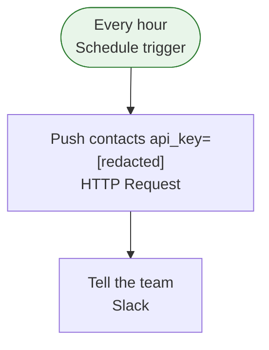

[Back to index](index.md)

## CRM sync (hourly)

This workflow runs on a schedule: every 1 hour(s) at minute 00 (timezone Asia/Makassar). Along the way it uses HTTP API (custom endpoint) and Slack. When it fails, an error workflow is notified.

| Item | Value |
| --- | --- |
| Active | yes |
| Nodes | 3 |
| Tags | client-demo |
| Trigger | Every hour (schedule) |
| Schedule | every 1 hour(s) at minute 00 (timezone Asia/Makassar) |

### Flow

### Steps

1. Every hour (Schedule trigger). Next: Push contacts api\_key=\[redacted\]
2. Push contacts api\_key=\[redacted\] (HTTP Request, POST a custom endpoint (host hidden)). Next: Tell the team
3. Tell the team (Slack, message / post)

### External services

| Service | Used by node(s) | Credential(s) (name / type) |
| --- | --- | --- |
| HTTP API (custom endpoint) | Push contacts api\_key=\[redacted\] | CRM API key / httpHeaderAuth |
| Slack | Tell the team | Slack bot / slackApi |

### Credentials (names and types only, never values)

| Name | Type | Node(s) |
| --- | --- | --- |
| CRM API key | httpHeaderAuth | Push contacts api\_key=\[redacted\] |
| Slack bot | slackApi | Tell the team |

### Environment variables and n8n variables referenced

None.

### Webhooks

None.

### Error handling

- Error workflow: Error alert
- Retry on fail: Push contacts api\_key=\[redacted\] (max 3 tries)
- Continue on fail: not used
- Error output branch: not used

### Rate limits and caps

No explicit caps found in node settings.

### Sub-workflows called

None.

### Warnings

None.

### When it breaks

| Area | Symptom | Likely cause | Where to look |
| --- | --- | --- | --- |
| HTTP API (custom endpoint) | 401 / 403 | Token expired, key rotated, or header/auth settings changed | Node(s): Push contacts api\_key=\[redacted\]. Check the credential attached to the request node |
| HTTP API (custom endpoint) | 429 / 5xx / timeout | Remote API is rate limiting or down | Node(s): Push contacts api\_key=\[redacted\]. Use retry-on-fail with wait; read Retry-After in the failed execution |
| HTTP API (custom endpoint) | Response shape changed | A field was renamed, so expressions downstream return undefined or empty | Node(s): Push contacts api\_key=\[redacted\]. Open the failed execution, compare the response with the field the next node reads |
| HTTP API (custom endpoint) | DNS / TLS error | Endpoint moved or its certificate expired | Node(s): Push contacts api\_key=\[redacted\]. Open the URL from the n8n server |
| Slack | Auth failed | Bot token or API key revoked/regenerated, or the bot was removed from the channel/chat | Node(s): Tell the team. Re-add the bot; replace the credential |
| Slack | 429 / flood limits | Provider send-rate limit (messages per second or per chat) | Node(s): Tell the team. Space out sends with a Wait node |
| Slack | Message rejected | Message too long, bad formatting, or recipient opted out or is invalid | Node(s): Tell the team. Open the failed execution and read the response body |
| Schedule trigger | Run did not fire | Workflow is inactive (it deactivates if saved with errors, or after import), n8n was down at the scheduled time (missed runs are not replayed), or the timezone differs from what you expect | Node(s): Every hour. Check the workflow Active toggle, the n8n timezone setting, and Executions around the expected time |

First step for any failure: n8n &gt; Executions &gt; filter by this workflow &gt; open the red execution &gt; the failing node is highlighted and its error text is on the right.
