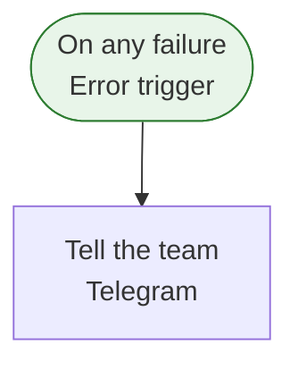

[Back to index](index.md)

## Error alert

This workflow runs when another workflow fails (it is an error workflow). Along the way it uses Telegram. It is an error handler for other workflows.

| Item | Value |
| --- | --- |
| Active | yes |
| Nodes | 2 |
| Tags | none |
| Trigger | On any failure (error) |
| Schedule | not scheduled |

### Flow

### Steps

1. On any failure: Error trigger. Next: Tell the team
2. Tell the team: Telegram

### External services

| Service | Used by node(s) | Credential(s) (name / type) |
| --- | --- | --- |
| Telegram | Tell the team | Alert bot / telegramApi |

### Credentials (names and types only, never values)

| Name | Type | Node(s) |
| --- | --- | --- |
| Alert bot | telegramApi | Tell the team |

### Environment variables and n8n variables referenced

- $env: ALERT\_CHAT\_ID

### Webhooks

None.

### Error handling

- This workflow IS an error workflow (has an Error Trigger).
- Retry on fail: Tell the team (max 3 tries)
- Continue on fail: not used
- Error output branch: not used

### Rate limits and caps

No explicit caps found in node settings.

### Sub-workflows called

None.

### Warnings

None.

### When it breaks

| Area | Symptom | Likely cause | Where to look |
| --- | --- | --- | --- |
| Telegram | Auth failed | Bot token or API key revoked/regenerated, or the bot was removed from the channel/chat | Node(s): Tell the team. Re-add the bot; replace the credential |
| Telegram | 429 / flood limits | Provider send-rate limit (messages per second or per chat) | Node(s): Tell the team. Space out sends with a Wait node |
| Telegram | Message rejected | Message too long, bad formatting, or recipient opted out or is invalid | Node(s): Tell the team. Open the failed execution and read the response body |

First step for any failure: n8n &gt; Executions &gt; filter by this workflow &gt; open the red execution &gt; the failing node is highlighted and its error text is on the right.
