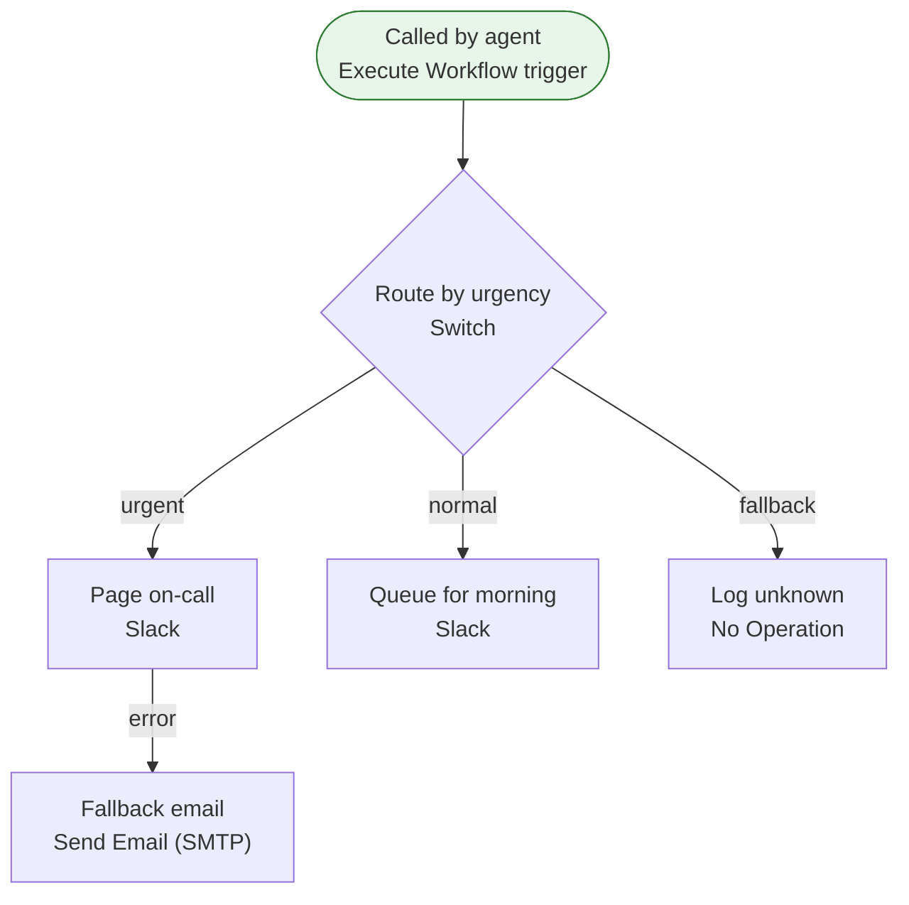

[Back to index](index.md)

## Escalation to Slack

This workflow is called by another workflow. Along the way it uses Slack and SMTP email. It makes decisions at “Route by urgency”. If it fails, nothing is notified automatically.

| Item | Value |
| --- | --- |
| Active | yes |
| Nodes | 6 |
| Tags | none |
| Trigger | Called by agent (subworkflow) |
| Schedule | not scheduled |

### Flow

### Steps

1. Called by agent (Execute Workflow trigger). Next: Route by urgency
2. Route by urgency (Switch, routes to 2 case(s)). Next: Page on-call (urgent), Queue for morning (normal), Log unknown (fallback)
3. Page on-call (Slack, message / post). Next: Fallback email (error)
4. Queue for morning (Slack, message / post)
5. Log unknown (No Operation)
6. Fallback email (Send Email (SMTP))

### External services

| Service | Used by node(s) | Credential(s) (name / type) |
| --- | --- | --- |
| Slack | Page on-call, Queue for morning | Slack bot / slackApi |
| SMTP email | Fallback email | SMTP relay / smtp |

### Credentials (names and types only, never values)

| Name | Type | Node(s) |
| --- | --- | --- |
| Slack bot | slackApi | Page on-call, Queue for morning |
| SMTP relay | smtp | Fallback email |

### Environment variables and n8n variables referenced

None.

### Webhooks

None.

### Error handling

- Error workflow: not set
- Retry on fail: not used
- Continue on fail: not used
- Error output branch: Page on-call

> **Warning:** No error workflow is set: a failure is visible only in the n8n Executions list.

> **Warning:** No node that calls an external service has retry-on-fail enabled.

### Rate limits and caps

No explicit caps found in node settings.

### Sub-workflows called

None.

### Warnings

None.

### When it breaks

| Area | Symptom | Likely cause | Where to look |
| --- | --- | --- | --- |
| Slack | Auth failed | Bot token or API key revoked/regenerated, or the bot was removed from the channel/chat | Node(s): Page on-call, Queue for morning. Re-add the bot; replace the credential |
| Slack | 429 / flood limits | Provider send-rate limit (messages per second or per chat) | Node(s): Page on-call, Queue for morning. Space out sends with a Wait node |
| Slack | Message rejected | Message too long, bad formatting, or recipient opted out or is invalid | Node(s): Page on-call, Queue for morning. Open the failed execution and read the response body |
| SMTP email | Auth failed | Mailbox password or app password changed, API key rotated, or 2FA policy changed | Node(s): Fallback email. Replace the credential; for Gmail-style SMTP use an app password |
| SMTP email | Sending limit reached | Daily send cap of the provider or mailbox reached | Node(s): Fallback email. Check provider limits; spread sends over time |
| SMTP email | Delivered to spam or bounced | SPF/DKIM/DMARC missing or sender domain changed | Node(s): Fallback email. Check DNS records and the provider bounce log |

First step for any failure: n8n &gt; Executions &gt; filter by this workflow &gt; open the red execution &gt; the failing node is highlighted and its error text is on the right.
