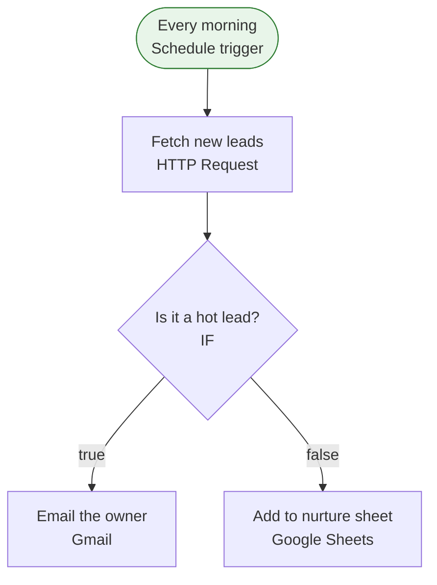

[Back to index](index.md)

## Lead alerts (daily)

This workflow runs on a schedule: every 1 day(s) at 08:00 (timezone Asia/Makassar). Along the way it uses HTTP API (custom endpoint), Gmail and Google Sheets. It makes decisions at "Is it a hot lead?". When it fails, an error workflow is notified.

| Item | Value |
| --- | --- |
| Active | yes |
| Nodes | 5 |
| Tags | client-demo |
| Trigger | Every morning (schedule) |
| Schedule | every 1 day(s) at 08:00 (timezone Asia/Makassar) |

### Flow

### Steps

1. Every morning: Schedule trigger. Next: Fetch new leads
2. Fetch new leads: HTTP Request, GET a custom endpoint (host hidden). Next: Is it a hot lead?
3. Is it a hot lead?: IF, checks 1 condition(s). Next: Email the owner (true), Add to nurture sheet (false)
4. Email the owner: Gmail, message / send
5. Add to nurture sheet: Google Sheets, sheet / append

### External services

| Service | Used by node(s) | Credential(s) (name / type) |
| --- | --- | --- |
| HTTP API (custom endpoint) | Fetch new leads | CRM API key / httpHeaderAuth |
| Gmail | Email the owner | Owner Gmail / gmailOAuth2 |
| Google Sheets | Add to nurture sheet | Sheets (agency) / googleSheetsOAuth2Api |

### Credentials (names and types only, never values)

| Name | Type | Node(s) |
| --- | --- | --- |
| CRM API key | httpHeaderAuth | Fetch new leads |
| Owner Gmail | gmailOAuth2 | Email the owner |
| Sheets (agency) | googleSheetsOAuth2Api | Add to nurture sheet |

### Environment variables and n8n variables referenced

- $env: CRM\_TENANT

### Webhooks

None.

### Error handling

- Error workflow: Error alert
- Retry on fail: Fetch new leads (max 3 tries, 2000 ms apart)
- Continue on fail: not used
- Error output branch: not used

### Rate limits and caps

- "Fetch new leads": request timeout 15000 ms

### Sub-workflows called

None.

### Warnings

None.

### When it breaks

| Area | Symptom | Likely cause | Where to look |
| --- | --- | --- | --- |
| HTTP API (custom endpoint) | 401 / 403 | Token expired, key rotated, or header/auth settings changed | Node(s): Fetch new leads. Check the credential attached to the request node |
| HTTP API (custom endpoint) | 429 / 5xx / timeout | Remote API is rate limiting or down | Node(s): Fetch new leads. Use retry-on-fail with wait; read Retry-After in the failed execution |
| HTTP API (custom endpoint) | Response shape changed | A field was renamed, so expressions downstream return undefined or empty | Node(s): Fetch new leads. Open the failed execution, compare the response with the field the next node reads |
| HTTP API (custom endpoint) | DNS / TLS error | Endpoint moved or its certificate expired | Node(s): Fetch new leads. Open the URL from the n8n server |
| Gmail | Auth expired or revoked | Refresh token expired or revoked: password change, access removed, or (Google Cloud app left in "Testing" mode) refresh tokens expire after 7 days | Node(s): Email the owner. Reconnect the credential, then re-run the failed execution |
| Gmail | 429 / quota exceeded | Per-minute or daily Google API quota hit, often from a loop calling the node once per item | Node(s): Email the owner. Add batching or a Wait node; check the Google Cloud console quota page |
| Gmail | Schema change | Sheet column renamed or moved, folder or file deleted or unshared | Node(s): Email the owner. Open the target sheet/folder and compare against the column or ID the node expects |
| Google Sheets | Auth expired or revoked | Refresh token expired or revoked: password change, access removed, or (Google Cloud app left in "Testing" mode) refresh tokens expire after 7 days | Node(s): Add to nurture sheet. Reconnect the credential, then re-run the failed execution |
| Google Sheets | 429 / quota exceeded | Per-minute or daily Google API quota hit, often from a loop calling the node once per item | Node(s): Add to nurture sheet. Add batching or a Wait node; check the Google Cloud console quota page |
| Google Sheets | Schema change | Sheet column renamed or moved, folder or file deleted or unshared | Node(s): Add to nurture sheet. Open the target sheet/folder and compare against the column or ID the node expects |
| Schedule trigger | Run did not fire | Workflow is inactive (it deactivates if saved with errors, or after import), n8n was down at the scheduled time (missed runs are not replayed), or the timezone differs from what you expect | Node(s): Every morning. Check the workflow Active toggle, the n8n timezone setting, and Executions around the expected time |

First step for any failure: n8n &gt; Executions &gt; filter by this workflow &gt; open the red execution &gt; the failing node is highlighted and its error text is on the right.
