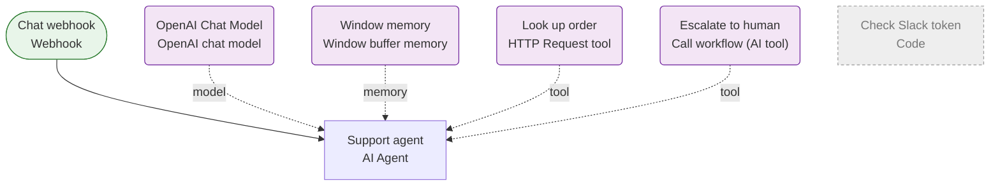

[Back to index](index.md)

## Support chat agent

This workflow receives an HTTP request (webhook). Along the way it uses OpenAI and Stripe. "Support agent" is an AI step wired to model: OpenAI Chat Model; memory: Window memory; tool: Look up order, Escalate to human. It hands work to 1 other workflow(s). If it fails, nothing is notified automatically.

| Item | Value |
| --- | --- |
| Active | yes |
| Nodes | 7 |
| Tags | client-demo |
| Trigger | Chat webhook (webhook) |
| Schedule | not scheduled |

### Flow

### Steps

1. Chat webhook: Webhook. Next: Support agent
2. Support agent: AI Agent. Uses model: OpenAI Chat Model; memory: Window memory; tool: Look up order, Escalate to human
3. Check Slack token: Code, runs custom JavaScript code \[DISABLED\]

### External services

| Service | Used by node(s) | Credential(s) (name / type) |
| --- | --- | --- |
| OpenAI | OpenAI Chat Model | OpenAI (client) / openAiApi |
| Stripe | Look up order | Stripe read-only / httpHeaderAuth |

### Credentials (names and types only, never values)

| Name | Type | Node(s) |
| --- | --- | --- |
| OpenAI (client) | openAiApi | OpenAI Chat Model |
| Stripe read-only | httpHeaderAuth | Look up order |

### Environment variables and n8n variables referenced

None.

### Webhooks

| Node | Method | Path | URL | Auth | Responds |
| --- | --- | --- | --- | --- | --- |
| Chat webhook | POST | support-chat | https://&lt;your-n8n-host&gt;/webhook/support-chat | none | lastNode |

### Error handling

- Error workflow: not set
- Retry on fail: not used
- Continue on fail: not used
- Error output branch: not used

> **Warning:** No error workflow is set: a failure is visible only in the n8n Executions list.

> **Warning:** No node that calls an external service has retry-on-fail enabled.

### Rate limits and caps

- "Support agent": AI agent iteration cap 6

### Sub-workflows called

- Escalate to human (as an AI tool) calls [Escalation to Slack](escalation-to-slack.md)

### Warnings

- Webhook "Chat webhook" has no authentication: anyone who knows the URL can trigger it.
- Pinned (frozen) test data exists on 1 node(s): Chat webhook. Pinned data replaces live output during manual test runs and can contain real customer data. Unpin before sharing the export.
- 1 possible hard-coded secret(s) found inside node parameters (listed by location, values masked). Move them to credentials or environment variables.
- 1 disabled node(s) are part of this workflow and are excluded from the service list.

| Node | Location | What it looks like | Value |
| --- | --- | --- | --- |
| Check Slack token | jsCode | assignment to "apiKey" | \[masked, 24 chars\] |

### When it breaks

| Area | Symptom | Likely cause | Where to look |
| --- | --- | --- | --- |
| OpenAI | 401 / 403 auth failure | API key rotated or billing/credit exhausted (often shown as 401 or 402) | Node(s): OpenAI Chat Model. Check key and billing in the provider console; replace credential |
| OpenAI | 429 rate limit | Per-minute token or request limit, or free-tier daily cap | Node(s): OpenAI Chat Model. Add retry-on-fail with a wait, reduce parallel runs, or switch model |
| OpenAI | Model deprecated or renamed | Provider retired the model name configured in the node | Node(s): OpenAI Chat Model. Pick a current model in the node settings |
| OpenAI | Output no longer parses | Model replied in a different shape, so an output parser or the next node fails | Node(s): OpenAI Chat Model. Open the failed execution, read the raw model reply, tighten the prompt/schema |
| OpenAI | Context too long | Input grew past the model context window | Node(s): OpenAI Chat Model. Truncate or summarise input before the model node |
| Stripe | 401 / 403 auth failure | API key rotated, revoked, or the plan/permissions changed | Node(s): Look up order. Replace the key in the credential; test the node |
| Stripe | 429 / rate limited | Plan limit or per-minute limit reached | Node(s): Look up order. Check provider usage page; add Wait or batching |
| Stripe | Schema change | Field renamed, ID deleted, or API version retired | Node(s): Look up order. Open the failing node, run it with the last input, read the error body |
| Webhook trigger | Webhook not reached or returns 404 | Workflow inactive, or the sender uses the test URL instead of the production URL, or the path changed | Node(s): Chat webhook. Check Active toggle and the exact path/method shown in this document |
| Webhook trigger | Anyone who knows the URL can trigger it | Webhook has no authentication configured | Node(s): Chat webhook. Add header or basic auth on the Webhook node, or validate a shared secret in the first node |
| Sub-workflows | Sub-workflow call fails | The called workflow is inactive, renamed, deleted, or expects different input fields. Its error shows as a failure of the caller | Node(s): Escalate to human. Open the called workflow and its latest execution; compare input fields |
| AI agent | AI agent loops, stalls or returns nonsense | Iteration cap reached, a tool errored, or the model passed bad arguments to a tool | Node(s): Support agent. Open the failed execution and read the agent step-by-step log; check each tool node separately |

First step for any failure: n8n &gt; Executions &gt; filter by this workflow &gt; open the red execution &gt; the failing node is highlighted and its error text is on the right.
